# Physical database design

This design follows the [approved scope](IMPLEMENTATION_GREENLIGHT.md) and
[actual source inspection](DATA_INSPECTION.md). The initial model is in `sql/` and
`mongodb/schema.py`. Additive migration 002 adds sessions; migration
`sql/migrations/003_case_operations.sql` brings construction to schema version 3
with content revisions and durable case recovery tasks (29 October 2026).
Migration [004_account_deletion.sql](../sql/migrations/004_account_deletion.sql)
adds a guarded account-deletion function and advances construction to schema
version **4** (30 October). Existing rows and source imports are retained.

## Relational model

```mermaid
erDiagram
    MANUFACTURER ||--o{ MANUFACTURER_MAKE : associated
    VEHICLE_MAKE ||--o{ MANUFACTURER_MAKE : associated
    VEHICLE_MAKE ||--o{ VEHICLE_MODEL : contains
    VEHICLE_MODEL ||--o{ MODEL_YEAR : has
    MODEL_YEAR ||--o{ VEHICLE_SOURCE : observed_in
    MANUFACTURER ||--o{ RECALL : reported_by
    RECALL ||--o{ RECALL_VEHICLE : affects
    MODEL_YEAR ||--o{ RECALL_VEHICLE : covered_by
    RECALL_VEHICLE ||--o{ RECALL_RECORD : has_component_rows
    OFFICIAL_INVESTIGATION ||--o{ INVESTIGATION_VEHICLE : affects
    MODEL_YEAR ||--o{ INVESTIGATION_VEHICLE : investigated
    OFFICIAL_INVESTIGATION ||--o{ INVESTIGATION_MANUFACTURER : involves
    MANUFACTURER ||--o{ INVESTIGATION_MANUFACTURER : involved_in
    OFFICIAL_INVESTIGATION ||--o{ INVESTIGATION_COMPONENT : covers
    OFFICIAL_INVESTIGATION ||--o{ INVESTIGATION_RECALL : references
    APP_USER ||--o{ SAVED_VEHICLE : saves
    APP_USER ||--o{ APP_SESSION : signs_in
    MODEL_YEAR ||--o{ SAVED_VEHICLE : saved_as
    APP_USER ||--o{ ANALYSIS_CASE : creates
    MODEL_YEAR ||--o{ ANALYSIS_CASE : concerns
    ANALYSIS_CASE ||--o{ CASE_STATUS_HISTORY : records
    APP_USER ||--o{ CASE_CONTENT_OPERATION : owns_recovery
    APP_USER ||--o{ CASE_CONTENT_OPERATION : requests
    APP_USER ||--o{ FLEET : owns
    FLEET ||--o{ FLEET_VEHICLE : contains
    MODEL_YEAR ||--o{ FLEET_VEHICLE : identifies
    FLEET_VEHICLE ||--o{ WORK_ORDER : tracks
    RECALL_VEHICLE ||--o{ WORK_ORDER : permits

    MANUFACTURER {
        bigint manufacturer_id PK
        text name UK
    }
    VEHICLE_MAKE {
        bigint make_id PK
        text name UK
    }
    MANUFACTURER_MAKE {
        bigint manufacturer_id FK
        bigint make_id FK
    }
    VEHICLE_MODEL {
        bigint model_id PK
        bigint make_id FK
        text name
    }
    MODEL_YEAR {
        bigint model_year_id PK
        bigint model_id FK
        integer year
    }
    VEHICLE_SOURCE {
        bigint model_year_id FK
        text source_name
    }
    RECALL {
        bigint recall_id PK
        text campaign_number UK
        bigint reporting_manufacturer_id FK
        date report_date
        text summary
        text consequence
        text remedy
    }
    RECALL_VEHICLE {
        bigint recall_id FK
        bigint model_year_id FK
    }
    RECALL_RECORD {
        text source_record_id PK
        bigint recall_id FK
        bigint model_year_id FK
        text component
        date manufacturing_started
        date manufacturing_ended
    }
    OFFICIAL_INVESTIGATION {
        bigint investigation_id PK
        text investigation_number UK
        text investigation_type
        date opened_date
        date closed_date
        text status
        text summary
    }
    INVESTIGATION_VEHICLE {
        bigint investigation_id FK
        bigint model_year_id FK
    }
    INVESTIGATION_MANUFACTURER {
        bigint investigation_id FK
        bigint manufacturer_id FK
    }
    INVESTIGATION_COMPONENT {
        bigint investigation_id FK
        text component
    }
    INVESTIGATION_RECALL {
        bigint investigation_id FK
        text campaign_number
    }
    APP_USER {
        bigint user_id PK
        text email UK
        text password_hash
        text role
        timestamptz created_at
    }
    SAVED_VEHICLE {
        bigint saved_vehicle_id PK
        bigint user_id FK
        bigint model_year_id FK
        text nickname
        timestamptz saved_at
    }
    APP_SESSION {
        text token_hash PK
        bigint user_id FK
        timestamptz created_at
        timestamptz expires_at
    }
    ANALYSIS_CASE {
        bigint case_id PK
        bigint model_year_id FK
        bigint created_by FK
        bigint assigned_to FK
        text title
        text priority
        text status
        timestamptz created_at
        timestamptz closed_at
        bigint content_revision
    }
    CASE_STATUS_HISTORY {
        bigint history_id PK
        bigint case_id FK
        text old_status
        text new_status
        timestamptz changed_at
    }
    CASE_CONTENT_OPERATION {
        uuid operation_id PK
        bigint case_id
        bigint owner_id FK
        bigint requested_by FK
        bigint revision
        text request_hash
        text action
        text state
        jsonb payload
        text last_failure
        timestamptz created_at
        timestamptz completed_at
    }
    FLEET {
        bigint fleet_id PK
        bigint owner_id FK
        text name
    }
    FLEET_VEHICLE {
        bigint fleet_vehicle_id PK
        bigint fleet_id FK
        bigint model_year_id FK
        text label
    }
    WORK_ORDER {
        bigint work_order_id PK
        bigint fleet_vehicle_id FK
        bigint model_year_id FK
        bigint recall_id FK
        text status
        text notes
        timestamptz completed_at
    }
```



`analysis_case.assigned_to` is a second nullable relationship to `app_user`.
`data_import_log` audits import runs. `schema_version` identifies construction
version. See `sql/schema.sql` for every column, data type and constraint.

Important integrity rules:

- Make names, model names within a make, and model years within a model are unique.
- Campaign numbers and action numbers identify official records; affected vehicles
  are many-to-many. Imported official records are intended as reference data.
- One user can save a model-year identity once. A fleet can contain several physical
  vehicles of the same model-year, distinguished by user-supplied labels.
- A work order references both the specific fleet vehicle and an applicable
  `recall_vehicle` pair through composite foreign keys. This prevents a work order
  being attached to a recall for an unrelated model-year.
- Case priority/status and user role are constrained to the agreed values. Closed
  cases require `closed_at`; completed work orders require `completed_at`.
- A status-change trigger records case history. Deleting a case removes its SQL
  history; deleting a fleet cascades its local vehicles/orders.
- Manufacturer relationships reflect observed source associations, not an assumed
  single corporate parent. Investigations have many-to-many manufacturer links.

`vehicle_catalogue`, `vehicle_safety_summary`, and `fleet_recall_matches` are useful
SQL views. The safety summary aggregates recalls and investigations separately
before joining them, preventing a many-to-many join from multiplying counts.

On 28 October, [research_views.sql](../sql/research_views.sql) added eight public
views for recall/investigation records, their vehicle/component/manufacturer
relationships and source/linked-campaign details. The research API reader has
SELECT-only access to these views, without direct source-table or private
account/workflow access. `EXISTS` filters keep one parent campaign/investigation
per list item; recall component+vehicle filters share one source-row predicate.
Large affected-vehicle/source lists are paginated. See
[Backend step 5](BACKEND_STEP_5_OFFICIAL_RECORDS.md) for verified grants and behavior.

## MongoDB model

`complaints` holds one document per verified ODI identifier, with:

```text
_id / odiNumber: string
modelYearId: SQL external reference
vehicle: { make, model, year }
manufacturer: normalized source name
components: unique string array
incident: { crash, fire, injuries, fatalities }
mileage / occurrences: integer or null
receivedDate / incidentDate: BSON UTC date or null
narrative: public source text
source: { archives[], rowIds[], componentRowCount, conflictingScalarColumns[] }
```

`case_details` holds application-owned flexible content:

```text
caseId: unique SQL analysis_case external reference
revision: ordered content version (new API cases)
linkedComplaints: ODI identifier strings[]
suspectedComponents: string[]
findings: [{ findingId, authorId, createdAt, observation }]
notes: [{ noteId, authorId, createdAt, text }]
tags: unique string[]
```

MongoDB JSON Schema validators check required fields and types. Indexes cover
vehicle/date, vehicle/date/ID pagination order, vehicle/component, narrative text,
and unique case identifiers. The stable-order index was added after controlled
measurement on 29 October; the shorter date index remains for established queries.
Component arrays are deduplicated. Component-group counts can overlap because one
complaint can concern several components; overall complaint counts use documents.

## Application responsibilities and implemented boundaries

SQL foreign keys cannot validate MongoDB references. The case backend now validates
complaint links against the case vehicle and derives authorship from the signed-in
user. SQL workflow changes and an outbox task commit together. The task projects a
versioned MongoDB snapshot/deletion, then SQL acknowledges it and clears its payload.
Explicit retries complete pending changes without duplicate notes/cases. This is
eventual consistency with durable recovery, not a distributed transaction.

`case_content_operation` intentionally has no foreign key to `analysis_case`: a
pending delete must remain recoverable after its SQL parent/history is deleted.
It keeps user foreign keys, unique request IDs, unique `(case_id,revision)` pairs,
and one PENDING task per case through a partial unique index. Completed payloads
are cleared; MongoDB owns synchronized notes/findings. SQL row/request locks
serialize API changes, while MongoDB's unique case ID and revision guards prevent
stale replacements. An applied task is a receipt and is not replayed over newer data.

The initial verification script exercises direct database operations. Read-only
research uses a SQL reader restricted to research views. Authentication now uses
a separate account with limited user-column/session permissions, signed cookies,
hashed server-side session tokens, role guards and guarded administrator changes;
see [Backend step 2](BACKEND_STEP_2_AUTH.md).

`app_session` references users with delete cascade. Its opaque token's SHA-256
hash is the primary key; raw tokens are not stored in SQL. Expiration is checked
on lookup. Logout deletes the row, and role checks join the current `app_user`
record rather than trusting a role cached in a cookie. Schema migration 002 adds
this table without replacing reference data.

Saved-vehicle CRUD now uses owner-scoped SQL predicates and a limited workflow
account; see [Backend step 3](BACKEND_STEP_3_SAVED_VEHICLES.md). The owner comes
from the authenticated session and cannot be changed by a request payload.
Only nickname updates are granted for saved records. Database row-level security
is not configured; the API supplies the ownership conditions.

Analysts manage cases they created; admins have explicit case oversight/recovery
access. The case SQL role cannot change creator/assignee/vehicle columns, read
account/session tables, write official records or delete recovery receipts. API
predicates supply owner checks; no row-level security is claimed. See
[Backend step 6](BACKEND_STEP_6_ANALYST_CASES.md) for the 29 October verification.
Fleet/vehicle/work-order APIs were verified on 29 October; see
[Backend step 7](BACKEND_STEP_7_FLEETS.md). Every role, including ADMIN, uses the
same personal owner predicate. The existing workflow SQL role now has narrow
fleet-table/recall-match-view grants, while owner/vehicle/recall identity updates
remain ungranted. Composite work-order foreign keys enforce both the vehicle's
model-year and the recall's affected model-year; uniqueness prevents duplicate
vehicle–recall orders. Parent-first fleet locks serialize mutations, and SQL
cascades remove dependent personal rows. No additional table migration was needed.
The first browser research/auth/personal-saves screens now call these established
API services; see [Frontend step 1](FRONTEND_STEP_1.md), verified on 29 October.
Performance/final evaluation remains. The analyst case browser workspace was added
in the subsequent step below.
No database migration was required for the first browser interface. A role column
alone does not enforce application permissions.
The complaint explorer and standalone record relationships also use the established
read-only APIs and grants; no schema/import changes were required. See
[Frontend step 2](FRONTEND_STEP_2.md), verified on 29 October with filter/history,
provenance, related-vehicle/source pagination and linked-recall browser checks.
The analyst workspace also uses the existing case APIs and outbox without a new
schema migration. [Frontend step 3](FRONTEND_STEP_3.md), verified on 29 October,
exposes applied/pending receipts, hides unsynchronized content and retries uncertain
commands with their original idempotency keys. Browser checks covered a lost
post-commit response, durable pending saves and recovery after SQL case deletion.
Fleet/order browser forms reuse the existing PostgreSQL transactions, constraints,
owner-scoped APIs and workflow role. [Frontend step 4](FRONTEND_STEP_4.md), verified
on 29 October, adds personal fleet/vehicle forms, matched recall orders, tracking
statuses and confirmed SQL cascades. Admins retain the same personal fleet boundary.
Uncertain fleet writes require reading current records before resubmission; they
do not use the case outbox or automatically repeat a write. No migration was needed.
Admin inventory/import monitoring uses two fixed SQL views from `sql/admin_views.sql`.
The existing reader receives SELECT on `admin_reference_counts` and
`admin_import_runs`, retaining no direct access to raw audit/account/session tables.
The import projection exposes validated source fingerprints and an allowed failure
category rather than arbitrary diagnostics. Counts, filters and pagination are
read-only; import filters bind values. ADMIN HTTP guards precede monitoring queries.
See [Frontend step 5](FRONTEND_STEP_5.md), verified on 29 October, including native
reader-permission/projection checks and a temporary-table last-admin guard test.
No table migration was required; SQL schema version remains 3. Existing auth SQL
connections retain their separate account/session and role-mutation permissions.
Public vehicle analytics reuses the existing restricted research views and indexes;
no grants, schema migration or reimport were required. A selected-identity SQL CTE
counts distinct official records across years without join multiplication. A
projected MongoDB `$facet` aggregates complaint totals/components/months/vehicle IDs
and overall date coverage. Only complaints use the selected inclusive UTC window;
official records use all stored dates. Missing dates, unknown incident attributes,
zero/partial months and overlapping component labels remain explicit.
See [Frontend step 6](FRONTEND_STEP_6.md), verified on 29 October, including real
data comparisons and validator-backed temporary-collection edge cases. These are
functional/counting checks. Subsequent [performance evaluation](PERFORMANCE_EVALUATION.md)
on 29 October compared two SQL recall queries and two complaint windows with 30
measured samples per phase, full-sized disposable copies and saved plans. Existing
SQL vehicle indexes reduced scan work. The measured MongoDB pagination improvement
adds `vehicle_received_ordered(modelYearId:1, receivedDate:-1, _id:-1)` through
`ensure_complaint_order_index` in `mongodb/schema.py`; a focused setup helper applies
it without reimporting. A separate native follow-up verified unchanged service
results, new-index/no-sort plans and retained existing counts/indexes. No SQL
migration, grant changes or API/UI changes were required. Index storage/write cost
and warm-cache/first-page measurement limits are explained in the report; broader
final evaluation remains.
The `postgres` account remains for trusted construction/imports and first-admin
bootstrap.

## Restricted account deletion — 30 October follow-up

The auth SQL role now has EXECUTE on `public.delete_unused_account(bigint,bigint,text)`
and still has no direct DELETE on `app_user` or direct reads of owned workflow
tables. The trusted-owner function uses a fixed safe search path and qualified
relations; PUBLIC execution is revoked. Its actor ID is supplied by the verified
Flask session. This is an application trust boundary, not database row-level security.

The function shares the role-change advisory lock, checks the actor's current
ADMIN role, locks actor/target rows and checks the current confirmation email.
Self-deletion, final-admin removal and any saved-vehicle/fleet/case/operation
references block deletion. This explicitly prevents the saved/fleet cascades that
would otherwise be allowed by their existing FKs. Only an unused account's session
rows may cascade. Pending and completed operation receipts protect case history
and MongoDB authorship references; the flow never writes MongoDB content.

See [account deletion](ACCOUNT_DELETION.md): 183 automated tests, 29 native assertions
and 23 live-database HTTP checks passed on 30 October, including target-session
revocation, role revocation while waiting, concurrent FK inserts and competing
admin deletions. The subsequent [30 October browser follow-up](account_deletion/browser-20261030T023324-1a1c57a4/frontend_report.json)
passed 238 cumulative checks, including confirmation/cancel, dependency rejection,
uncertain-response review, expiry, mobile layout and independent session revocation.
Screenshots were reviewed and owned fixtures removed; original counts/import
history remained. Only verifier readiness/viewport setup changed during that
follow-up; the earlier unit/native/API runs were not repeated. G1 is closed.
Admin import initiation was completed in the later follow-up below; final
evaluation remains separate work.

## Admin-authenticated import orchestration — 30 October follow-up

The supported admin initiation workflow is the local `scripts/admin_import.py`
helper. It signs in through existing Flask auth, requires a current ADMIN role,
checks the fixed archives against `docs/data_profile.json`, confirms the operator's
intent and rechecks role/session/identity and source fingerprints after taking the
shared session lock. It then runs the actual existing ETL. Admin monitoring stays
GET-only; no web job/worker or new privileged endpoint was added.

`etl/runner.py` now owns the ordered catalogue/recall/investigation/complaint
pipeline and PostgreSQL advisory lock `2003192026`, shared with the trusted initial
`import_all.py` path. The session lock spans stage commits; a transaction-only lock
would end too early. Statistics refresh is limited to imported relations on the
connection, so isolated verification does not analyze unrelated public tables.
No schema migration, grant expansion or account/data reset was needed; SQL schema
version remains 4. App credentials authenticate the human operator, while the
local setup credentials authorize the ETL's database writes.

Existing `data_import_log` rows still represent individual dataset stages, not a
new actor/job queue. Denied/cancelled/busy/preflight failures create no stage row.
Ordinary in-stage exceptions are logged FAILED; completed earlier stages remain.
MongoDB batches do not participate in the SQL transaction, and abrupt interruption
may leave a RUNNING audit row. Permission is checked at the start boundary, not
continually during every imported row. See [admin import](ADMIN_IMPORT.md) for the
operator contract and limits.

The milestone passed **196 automated tests and 32 native checks on 30 October**,
using actual auth/CLI/ETL and owned SQL/MongoDB/source fixtures. The repeat import
added no duplicate entities; real MongoDB validation failure recorded a failed
complaint stage with earlier SQL stages still completed. Original project counts/
audit rows were retained and all fixtures removed. No full real-source import or
cumulative browser rerun was performed for this terminal/static-note change.
G2 is closed; final rehearsal, reproduction and delivery materials remain.

## Integrated technical acceptance — 30 October follow-up

The later [technical rehearsal](TECHNICAL_REHEARSAL.md) passed **202 automated
tests, 238 browser checks and all selected native case/fleet/account/import checks**
against the fingerprinted working tree and both existing native databases. Case
recovery included recreating an owned API server/app instance; it did not require
stopping PostgreSQL or MongoDB services. Original counts/import history, raw archive
fingerprints and private configuration were retained, and owned fixtures were removed.

The run validated 20 saved benchmark plans and matched four current ordered query
result sets to their saved fingerprints. It did not rerun the 29 October timing
measurements. No application schema/grant change was made for this rehearsal;
SQL schema version remains 4. This completes the defined technical evaluation
milestone. Stage 9 still requires the final manual/package, teammate fresh setup,
report, slides/video and timed human presentation rehearsal.

