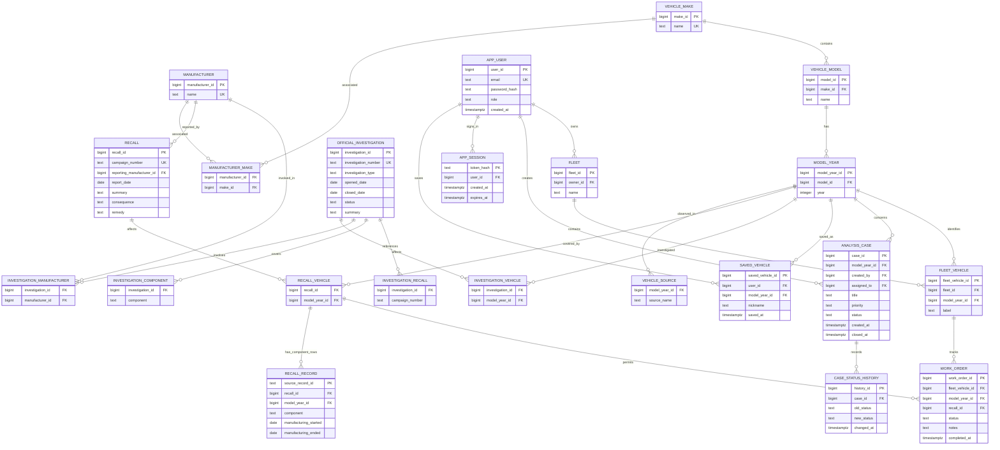

# Initial physical database design

This design follows the [approved scope](IMPLEMENTATION_GREENLIGHT.md) and
[actual source inspection](DATA_INSPECTION.md). The initial model is in `sql/` and
`mongodb/schema.py`; additive migration `sql/migrations/002_auth_sessions.sql`
brings SQL construction to schema version 2.

## Relational model



`analysis_case.assigned_to` is a second nullable relationship to `app_user`.
`data_import_log` audits import runs. `schema_version` identifies construction
version. See `sql/schema.sql` for every column, data type and constraint.

Important integrity rules:

- Make names, model names within a make, and model years within a model are unique.
- Campaign numbers and action numbers identify official records; affected vehicles
  are many-to-many. Imported official records are intended as reference data.
- One user can save a model-year identity once. A fleet can contain several physical
  vehicles of the same model-year, distinguished by user-supplied labels.
- A work order references both the specific fleet vehicle and an applicable
  `recall_vehicle` pair through composite foreign keys. This prevents a work order
  being attached to a recall for an unrelated model-year.
- Case priority/status and user role are constrained to the agreed values. Closed
  cases require `closed_at`; completed work orders require `completed_at`.
- A status-change trigger records case history. Deleting a case removes its SQL
  history; deleting a fleet cascades its local vehicles/orders.
- Manufacturer relationships reflect observed source associations, not an assumed
  single corporate parent. Investigations have many-to-many manufacturer links.

`vehicle_catalogue`, `vehicle_safety_summary`, and `fleet_recall_matches` are useful
SQL views. The safety summary aggregates recalls and investigations separately
before joining them, preventing a many-to-many join from multiplying counts.

## MongoDB model

`complaints` holds one document per verified ODI identifier, with:

```text
_id / odiNumber: string
modelYearId: SQL external reference
vehicle: { make, model, year }
manufacturer: normalized source name
components: unique string array
incident: { crash, fire, injuries, fatalities }
mileage / occurrences: integer or null
receivedDate / incidentDate: BSON UTC date or null
narrative: public source text
source: { archives[], rowIds[], componentRowCount, conflictingScalarColumns[] }
```

`case_details` holds application-owned flexible content:

```text
caseId: unique SQL analysis_case external reference
linkedComplaints: ODI identifier strings[]
suspectedComponents: string[]
findings: [{ findingId, authorId, createdAt, observation }]
notes: [{ noteId, authorId, createdAt, text }]
tags: unique string[]
```

MongoDB JSON Schema validators check required fields and types. Indexes cover
vehicle/date, vehicle/component, narrative text, and unique case identifiers.
Component arrays are deduplicated. Component-group counts can overlap because one
complaint can concern several components; overall complaint counts use documents.

## Application responsibilities for the next stage

SQL foreign keys cannot validate MongoDB references. The backend must validate
case/author/complaint references and ensure linked complaints match the case's
vehicle. Case creation must handle a MongoDB failure with rollback or explicit
compensation; case deletion must reconcile both stores. No distributed transaction
system is planned.

The initial verification script exercises direct database operations. Read-only
research uses a SQL reader restricted to research views. Authentication now uses
a separate account with limited user-column/session permissions, signed cookies,
hashed server-side session tokens, role guards and guarded administrator changes;
see [Backend step 2](BACKEND_STEP_2_AUTH.md).

`app_session` references users with delete cascade. Its opaque token's SHA-256
hash is the primary key; raw tokens are not stored in SQL. Expiration is checked
on lookup. Logout deletes the row, and role checks join the current `app_user`
record rather than trusting a role cached in a cookie. Schema migration 002 adds
this table without replacing reference data.

Saved-vehicle CRUD now uses owner-scoped SQL predicates and a limited workflow
account; see [Backend step 3](BACKEND_STEP_3_SAVED_VEHICLES.md). The owner comes
from the authenticated session and cannot be changed by a request payload.
Only nickname updates are granted for saved records. Database row-level security
is not configured; the API supplies the ownership conditions.

Case/fleet ownership, their editable APIs and the cross-database case service
remain backend work. A role column alone does not enforce application permissions.
The `postgres` account remains for trusted construction/imports and first-admin
bootstrap.

