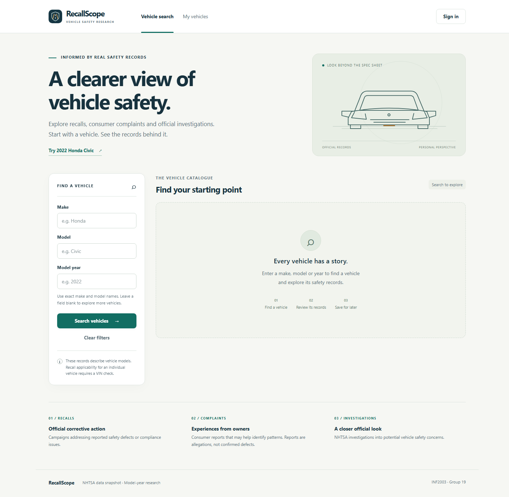
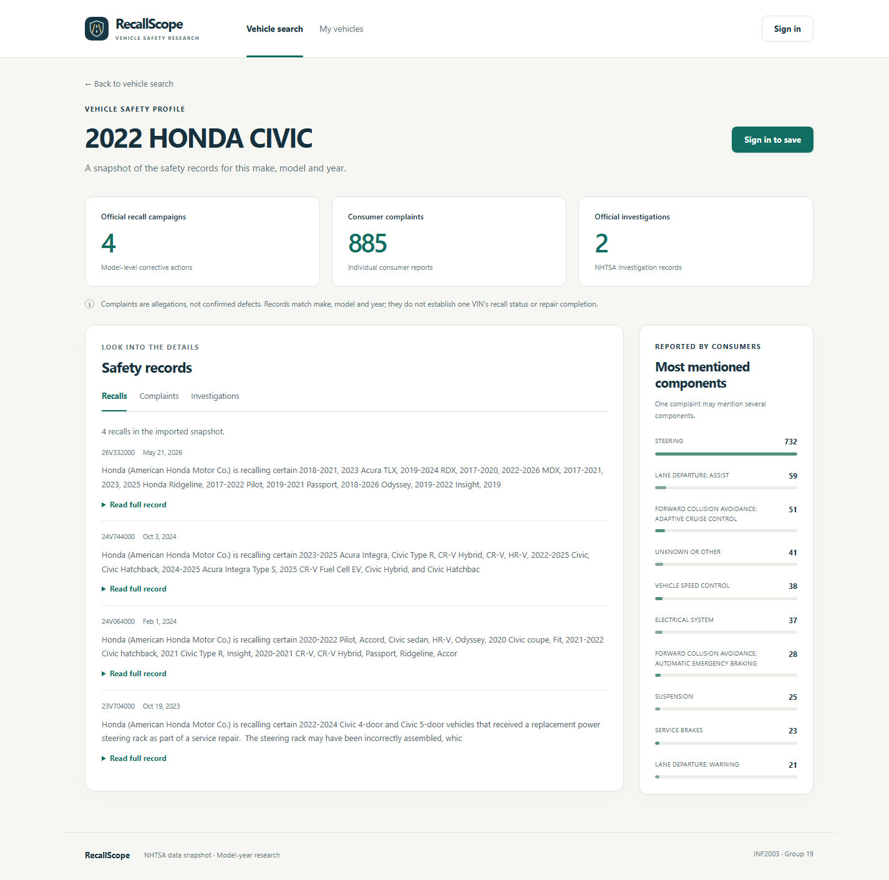

# Frontend step 1 — Browser research, sign-in and personal saves

Implemented and verified on **29 October 2026 (local time)**. The project now has
a responsive browser interface named **RecallScope**, served by the existing
Flask application. PostgreSQL/MongoDB and the established API services remain the
data layer. This begins overall roadmap Stage 7; it does not finish every screen.

## Open the application

If Flask is already running, stop that process with **Ctrl+C** first. From the
repository root, start it again and leave the terminal running:

```powershell
.\.venv\Scripts\python.exe -m flask --app backend:create_app run --host 127.0.0.1 --port 5000
```

Open [RecallScope](http://127.0.0.1:5000/) in your browser. A JSON response at `/`
means the older Flask process is still running; restart it to load the new pages.
Reload the browser after restarting. No reimport, new database password, package
installation or Node build is needed on the current machine to run the interface.

Use **Try 2022 Honda Civic**, then **View safety profile**. The verified snapshot
shows 4 official recall campaigns, 885 consumer complaints and 2 investigations.
Switch the record category, expand a full record, or move between complaint pages.
Component bars count complaint mentions, which can overlap across components;
they are not defect probabilities or a vehicle safety score.

Click **Sign in to save**. Use the application email/password you already chose
in registration, rather than the database credentials from `.env`. Alternatively,
create a normal account through the registration form. Returning from sign-in
preserves the selected vehicle. Save it with an optional nickname, then open
**My vehicles** to rename the nickname, revisit the profile or remove the bookmark.
Cancelling removal keeps the record. Saved changes persist after logout.

Terminal clients use their own cookies. Signing in through a terminal helper does
not automatically sign this browser in. No demo credentials were left by testing.

## Pages and working features

| Browser page | Implemented behavior |
| --- | --- |
| `/` or `/vehicles` | Make/model/year filters, exact-name matching, example search, clear filters, empty/error/loading states and paginated catalogue results. |
| `/vehicles/profile?year=2022&make=HONDA&model=CIVIC` | Combined counts, complaint component bars, paginated recall/complaint/investigation records and expandable full text/details. |
| `/login` | Real account login, password visibility toggle, error feedback and safe local return path. |
| `/register` | Normal-user registration, password confirmation and automatic sign-in. |
| `/saved-vehicles` | Owner's paginated saves, nickname changes, confirmation/cancellation of removal and signed-out/empty states. |

Research is public; saving/editing/removing requires sign-in. All personal data
still passes through the owner-scoped API checks. The UI displays an existing-save
message on duplicate saving and leaves the existing record intact. It does not
change existing personal ownership or analyst/admin rules.

Unknown component/narrative fields are rendered as text rather than interpreted
as HTML. Forms have labels, live feedback, keyboard-accessible buttons/dialogs and
a skip link. The layout adapts to a narrow screen; no third-party font, JavaScript
or stylesheet download is required. The small local stylesheet replaces the
earlier proposed Bootstrap styling, keeping the same HTML/JavaScript approach.

## What changes compared with the API-only milestone?

The existing `/api/...` research, auth, saved-vehicle, case and fleet endpoints
remain available. **The JSON discovery page moved from `/` to `/api`** because `/`
now opens the application. `scripts/verify_api.py` and its unit assertion were
updated to request `/api`; the earlier recorded HTTP report keeps its historical
root URL and verification date.

The Python terminal clients remain usable. Case/fleet/admin workflows still use
their APIs or terminal clients until their browser screens are built. Inside the
profile you can browse selected-vehicle complaints, but the dedicated complaint
explorer with the full component/date/incident/text filters is still planned.
Standalone record/source-relationship pages, case/fleet/admin workspaces,
dashboard analytics and performance benchmarks also remain.

## How the frontend works

1. Flask renders a page using a Jinja HTML template and serves local CSS/JavaScript.
2. Browser JavaScript sends same-origin `fetch()` requests to the existing APIs.
3. APIs validate input, sign-in/ownership and database operations as before.
4. JavaScript turns the returned JSON into cards, counts, record text and forms.

The browser is the frontend; it does not connect directly to PostgreSQL/MongoDB or
receive service passwords. Server-side SQL/MongoDB queries and authority remain
in the backend. Browser input checks are convenience checks in addition to server
validation, not replacements for it.

| File/folder | Responsibility |
| --- | --- |
| `backend/pages.py` | Page routes and HTML response headers. |
| `backend/templates/` | Shared layout, research/profile, auth and saved-vehicle page structures. |
| `backend/static/app.css` | Responsive visual styling and loading/error/dialog states. |
| `backend/static/app.js` | Page behavior and safe DOM text rendering. |
| `backend/static/api.js` | Same-origin JSON requests, cookie/CSRF handling and session-expiry signaling. |
| `backend/static/mark.svg` | Locally served vector brand mark. |

The UI keeps CSRF tokens in module memory, and sends the existing HttpOnly sign-in
cookie with same-origin requests. It does not put credentials/tokens in local or
session storage. Auth forms use POST as their HTML fallback, avoiding accidental
password query strings if JavaScript is unavailable. Local-only return-path
validation prevents a crafted sign-in link from redirecting to another website.

Page responses are no-store, and saved-page history restoration refreshes account
state before restoring private data. A Content Security Policy permits same-origin
scripts/styles/connections and disallows inline scripts and embedding. User fields
use text nodes/input values, rather than HTML interpolation. Read failures and
blocked requests leave retryable states; an expired session clears private saves
and prompts sign-in. Search cancellation prevents older results replacing newer
filters.

Primary implementation references: [Flask JavaScript/fetch patterns](https://flask.palletsprojects.com/en/stable/patterns/javascript/),
[Flask static files](https://flask.palletsprojects.com/en/stable/tutorial/static/),
and [Fetch credentials/cancellation](https://developer.mozilla.org/en-US/docs/Web/API/Fetch_API/Using_Fetch).

## Verification

On **29 October 2026**:

- **151 automated tests passed:** the previous 145 plus six page/API-boundary,
  credential-form, local-asset and response-header tests. JavaScript syntax checks passed.
- **32 real-browser checks passed in Chrome 156.0.8078.73**, at desktop and an
  emulated 390px mobile viewport, using the native project databases.
- Browser checks covered research/detail pages, pagination, sign-in return paths,
  password confirmation, registration/login/logout and saved-vehicle CRUD.
- Stored nickname markup was displayed literally; cancelling removal retained
  the save; duplicate saving preserved one bookmark; nickname edits survived reload.
- Account isolation, foreign saved-ID denial, logout/history privacy, unsafe return
  paths, empty results, an interrupted search/retry and loading-state cleanup passed.
- No uncaught browser JavaScript exceptions were recorded. Screenshots were visually
  reviewed, and a narrow-screen card layout was adjusted and verified again.
- Synthetic accounts/saves/sessions were removed, and checked existing/reference
  counts matched the starting counts. Earlier milestone reports were preserved.

Evidence: [frontend_step_1_verification_report.json](frontend_step_1_verification_report.json).
UTC evidence timestamps can fall on the previous date relative to local time.
These checks are not a full accessibility audit or proof of every browser/device.

```powershell
.\.venv\Scripts\python.exe -m unittest discover -s tests -v
.\.venv\Scripts\python.exe scripts/verify_frontend.py
```

The optional browser verifier uses the installed Chrome (or Edge) and Node.js 22+
to control an owned headless browser through its local DevTools protocol. It starts
and stops its own temporary Flask server, passes synthetic credentials through
stdin, and cleans up its fixtures/profile. Node is a verification tool here, not
an application runtime/build dependency. In the agent's restricted environment,
native browser launch required an approved execution outside the sandbox. It
does not register/publish a hosted Site or replace the native databases.

## Screenshots

The images show actual browser output using the imported dataset:





[Narrow-screen search screenshot](screenshots/frontend-step-1/search-mobile.png).

Next: extend the browser experience with full complaint filters and the case/fleet
workspaces, then admin dataset/import views and the analytics/evaluation work.
