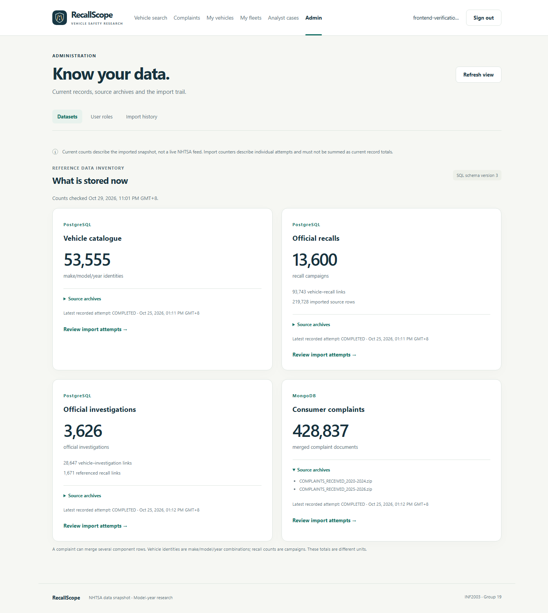

# Frontend step 5 — Admin roles, datasets and import history

Implemented and verified on **29 October 2026 (Asia/Kuala_Lumpur)**. This adds the
admin browser workspace and the missing dataset/import monitoring read APIs
(backend extension step 8). **Stage 7 remains in progress**: analytics/dashboard
integration is next, followed by performance evaluation and final deliverables.

## Open the admin workspace

Restart an older Flask terminal with Ctrl+C, then run:

```powershell
.\.venv\Scripts\python.exe -m flask --app backend:create_app run --host 127.0.0.1 --port 5000
```

Open [RecallScope](http://127.0.0.1:5000/), sign in with your **existing ADMIN
application account**, then select **Admin**. A persistent admin is already set
up on this computer; first-admin bootstrap does not need to be repeated.

Normal users and analysts cannot use these pages or their APIs. They retain
public research and their permitted personal/case workflows. An application admin
is a user role in our website, separate from the PostgreSQL setup login in `.env`.

The new SQL views/SELECT grants were applied locally using the existing reader
setup helper. Its stored credentials were retained. No database rebuild, dataset
reimport, schema-version increment or new runtime dependency was needed.

## Three views, three different questions

| Browser page | What it answers |
| --- | --- |
| `/admin` | What reference records are stored now, in which DBMS, and which archives are configured for them? |
| `/admin/users` | Which application role does each account have? |
| `/admin/imports` | Which import attempts were recorded, when did they run, and what did each attempt do? |

### Datasets: current inventory

The overview reads current PostgreSQL counts and the MongoDB complaint-document
count. It shows the SQL schema version and the most recent recorded attempt for
each dataset. It distinguishes the units:

| Dataset | Stored unit | Verified snapshot count |
| --- | --- | --- |
| Vehicle catalogue | Make/model/year identities | 53,555 |
| Official recalls | Recall campaigns | 13,600 |
| Official investigations | NHTSA investigations | 3,626 |
| Consumer complaints | Merged complaint documents | 428,837 |

Recall source rows and related-vehicle links have separate counts. A source row
is not another campaign; a complaint may merge several component rows. Source
archive disclosures and **Review import attempts** links let you trace the inputs.
Counts are read during the request, rather than a live NHTSA feed or an atomic
snapshot spanning both DBMSs. Concurrent imports could change the result.

### User roles: confirmed access changes

Choose a role, click **Review change**, read the target account and before/after
roles, then confirm or cancel. Cancellation sends no role update. Registration
continues to create NORMAL_USER accounts; it cannot choose its own role.

- **Normal user:** public research, personal saves and owned fleets/work orders.
- **Analyst:** those features plus cases they created.
- **Admin:** role management, dataset/import views and oversight of analyst cases.
  Personal saves/fleets still enforce owner-only access.

The existing server checks the actor again under its role-mutation lock and
prevents demoting the last administrator. Permissions change on subsequent
requests using the existing session. Successful self-demotion clears the admin
workspace and navigation immediately. Logout, expired sessions and denied access
also clear private account/data views.

If a role update's response is lost/unreadable or the server cannot confirm it,
the page blocks further updates and offers **Refresh and review roles**. This
reads current identity and roles; it does not automatically repeat the write.

### Import history: past attempts, not current dataset sizes

Filter by the four project datasets and RUNNING/COMPLETED/FAILED. The list is
paginated, and the dataset/status/page query can be reopened from its URL. Each
attempt shows started/completed timestamps, rows read, inserted/updated entities,
skipped/rejected rows and an optional source fingerprint.

For example, the repeated complaint import in our snapshot read **626,410 source
rows**, skipped **9,224**, and refreshed **428,837 existing complaint documents**.
Those figures describe different units and processing steps. They do not mean
626,410 complaints were inserted, or that another 428,837 duplicates were added.
Summing counters across attempts does not give today's dataset size.

Earlier failed attempts remain in history after later successful loads. A FAILED
row describes that attempt; it does not by itself mean the current databases are
unavailable. A running attempt can have no completion timestamp. The catalogue
run has no single source fingerprint because it combines sources; the complaint
fingerprint can contain two SHA-256 hashes separated by a colon, one per archive.

Failure information is limited to an allowed exception-category list. Arbitrary
diagnostics become `OTHER_IMPORT_ERROR`; raw error text, source rows, passwords and
connection details are not returned. Fingerprints must match the expected hash
format before they are exposed. Import monitoring is read-only; imports remain
an intentional local CLI operation.

## Backend extension and SQL access

| API | Access and behavior |
| --- | --- |
| `GET /api/admin/datasets` | ADMIN only; current reference counts, schema version, source archive names and latest recorded attempt per dataset. No query parameters. |
| `GET /api/admin/import-runs` | ADMIN only; optional `dataset`, `status`, `page` (1–10,000), `pageSize` (1–100, default 20). Unknown/duplicate/invalid parameters are rejected. |
| `GET /api/admin/users` | Existing ADMIN-only paginated account list; only user ID/email/role/creation time. |
| `PATCH /api/admin/users/{userId}/role` | Existing ADMIN-only role change, with CSRF, locked actor recheck and last-admin protection. |

Monitoring reads use the existing restricted SQL reader through two new views:
`admin_reference_counts` and `admin_import_runs`. SELECT grants apply to those
views. The reader still cannot directly read/write `data_import_log`,
`schema_version`, `app_user` or `app_session`. Reference counts use fixed SQL;
import filters use bound parameters. MongoDB counts are bounded to five seconds.
The application already uses separate auth connections for account/session work.

The HTML pages are shells with no stored private data. Browser code requests
protected data through the same-origin API client. User text uses DOM text nodes
and input values. All admin API responses retain no-store headers. API protection
is independent of whether the navigation link is visible.

On a teammate's existing setup, update the monitoring views/grants once using:

```powershell
.\.venv\Scripts\python.exe scripts/setup_readonly_user.py
```

That helper preserves existing data and reuses configured reader credentials.
New setups also get the views through database construction. This local machine
has already received the update; only a Flask restart is needed to open the pages.

## Verification

On **29 October 2026**:

- **159 automated tests passed:** the earlier 151 plus eight monitoring tests for
  role gates, read-only methods, DTOs, bounded parameterized queries, invalid input,
  missing completion/fingerprints and sanitized SQL/MongoDB failures. Page coverage
  was extended to all three admin shells and the new module.
- **195 real-browser checks passed in Chrome 156.0.8078.73**, including all earlier
  research/auth/saved/case/fleet journeys and the new admin flows.
- Admin checks covered anonymous/normal/analyst denial, dataset units/sources,
  read failure/retry, filtered/paginated import history, invalid/empty states,
  fingerprint display and read-only monitoring methods.
- Confirm/cancel, native role changes, lost-response review, user pagination,
  self-demotion, logout/history and session-expiry cleanup passed. User-list
  screenshots show synthetic accounts only; existing users were not edited.
- The real last-admin repository SQL was checked against an isolated temporary
  table containing only a synthetic admin, then rolled back. The browser's 409
  rejection display was separately checked using an injected response so existing
  administrators never needed to be demoted.
- Native SQL permission checks confirmed view-only monitoring access. An owned,
  uncommitted audit fixture verified diagnostic/fingerprint sanitization and was
  rolled back; original import history was retained.
- Desktop and 390px mobile output were reviewed. No uncaught browser JavaScript
  exceptions were recorded. Owned users/sessions/saves/cases/content/tasks/fleets/
  orders were removed; checked existing/reference counts matched the baseline.

Evidence: [frontend_step_5_verification_report.json](frontend_step_5_verification_report.json).
Earlier milestone reports remain historical. These checks are not a complete
accessibility audit, every-browser guarantee or performance benchmark.

```powershell
.\.venv\Scripts\python.exe -m unittest discover -s tests -v
.\.venv\Scripts\python.exe scripts/verify_frontend.py --admin
```

The optional verifier uses installed Chrome/Edge and Node.js 22+, owns/stops its
temporary server/browser and passes synthetic credentials through stdin. `--admin`
includes the earlier journeys and writes step-5 evidence/screenshots without
overwriting steps 1–4. Temporary SQL fixtures are rolled back; sequence counters
can advance during tests. Existing accounts, roles and running services remain.

## Screenshots and next work



[User roles using synthetic accounts](screenshots/frontend-step-5/admin-users.png),
[import history](screenshots/frontend-step-5/admin-imports.png) and
[mobile inventory](screenshots/frontend-step-5/admin-mobile.png).

Next: analytics/dashboard queries and their browser presentation. Performance
experiments, broader final evaluation, report/slides/video and submission packaging
remain. Completing admin screens does not complete the whole frontend or project.
