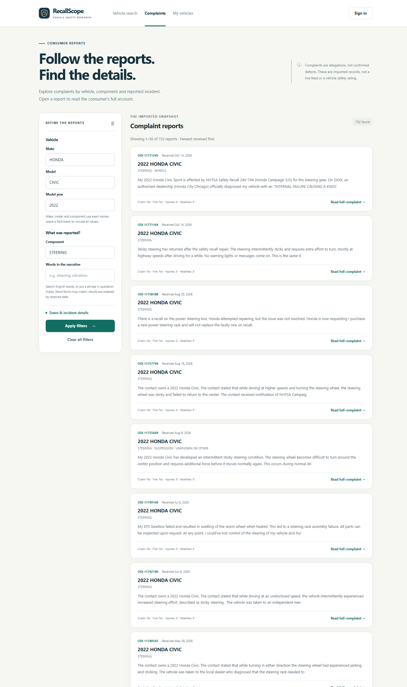
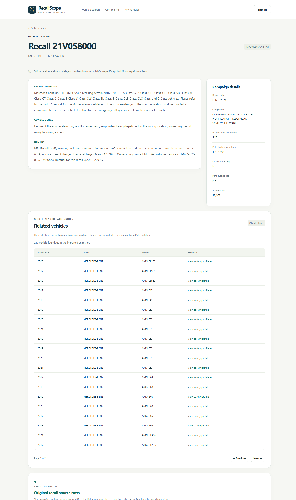

# Frontend step 2 — Complaint explorer and record relationships

Implemented and verified on **29 October 2026 (Asia/Kuala_Lumpur)**. This extends
RecallScope's browser research pages. Overall development remains in **Stage 7**;
the analyst workspace is the next browser milestone.

## Try it

Restart your existing Flask terminal with Ctrl+C, then run:

```powershell
.\.venv\Scripts\python.exe -m flask --app backend:create_app run --host 127.0.0.1 --port 5000
```

Open [RecallScope](http://127.0.0.1:5000/). Choose **Try 2022 Honda Civic**, open its
profile and click **Filter complaints**. That opens the explorer with the vehicle
fields filled in. The navigation's **Complaints** link opens the broader snapshot.
Research pages are public; no application account is needed for reading them.

1. The unfiltered Civic profile has **885 complaints** in our imported snapshot.
2. Enter **STEERING** as the component and click **Apply filters**. This snapshot
   returns **732** matching complaints.
3. Try narrative words or a phrase in quotation marks. Expand **Dates & incident
   details** to filter received dates, crashes, fires, injuries or fatalities.
4. Open **Read full complaint** to see the full narrative, dates, incident counts,
   vehicle-profile link and expandable source information.
5. From a vehicle profile's recall/investigation list, follow **Related vehicles &
   record details** to the new standalone official-record page.

You can share or reload the complaint URL: filters and page number are included
in it. Previous/Next keeps applied filters, while a new filter submission starts
at page 1. Back/forward navigation restores the displayed filters and results.
Unsaved edits to the filter form take effect when you click **Apply filters**.
Signing in from the explorer returns to the same applied filters. Return links
accept known local pages and reject external destinations and API routes.

## Available pages

| Browser page | What it provides |
| --- | --- |
| `/complaints` | Exact make/model/year/component filters, indexed English narrative search, inclusive received-date range, four incident filters, 50 reports per page and shareable URLs. |
| `/complaints/{odiNumber}` | Full consumer narrative, vehicle, components, dates, incident details and source provenance. |
| `/recalls/{campaignNumber}` | Summary, consequence, remedy, campaign facts, paginated vehicle identities and expandable paginated source rows. |
| `/investigations/{investigationNumber}` | Official summary, snapshot status, manufacturers/components, paginated vehicle identities and linked recall campaigns. |

The complaint controls expose human-readable research filters. Internal
`modelYearId` lookup remains available through the API; profile links fill the
equivalent make/model/year fields in the explorer.

Make/model/component filters match complete names, ignoring input case through
the existing API normalization. Text search uses the existing MongoDB English
text index, so word forms can match; it is not an arbitrary substring search.
Ordering remains newest received date first, with the existing stable tie-break.
Date filters refer to receipt of the complaint, not the incident itself.

## What the records mean

**Unknown does not mean no.** Each incident filter has an unrestricted choice.
Choosing **No** for crash/fire or **Zero reported** for injuries/fatalities excludes
unknown stored values. The report displays unknown counts as **Unknown**.
Consumer allegations and reported incidents do not establish confirmed defects.

**A source row is not a campaign.** For example, recall **21V058000** has **217
related vehicle identities** and **18,662 source rows** in this snapshot. Many
rows describe the same campaign with different components, vehicles or production
dates. The source table shows the archive and line used in the import. Opening
the disclosure loads only one page rather than all those rows at once.

**A vehicle identity is not a VIN.** Related vehicles are catalogue combinations
of make/model/year. Their links return to the combined vehicle safety profile;
they do not prove applicability or repair status for one particular car.

**Official investigations are separate from our analyst cases.** Their OPEN/CLOSED
label comes from the imported closing date. Linked recalls outside our snapshot
are labelled as references without a detail link. For example, **EA15002** contains
both available and unavailable campaign references in this import.

## Implementation and verification

The new Jinja templates are HTML shells. The browser reads the established
complaint and official-record APIs through the same-origin API client. Shared DOM
helpers live in `backend/static/ui.js`; `research.js` implements the new views.
Record text uses text nodes, not HTML interpretation. Existing cookie, CSRF,
ownership and backend validation rules continue to apply to authenticated work.

No database migration, reimport, new `.env` value or runtime dependency is needed.
The interface uses the existing Flask/Python packages and local CSS/JavaScript.

Verification on **29 October 2026**:

- **151 automated tests passed**, including the existing HTML/API boundary tests
  extended to all new pages and static modules; JavaScript syntax checks passed.
- **71 real-browser checks passed in Chrome 156.0.8078.73** against the native
  PostgreSQL/MongoDB databases. This includes the previous research/auth/saved
  journeys and the additional explorer/relationship journeys.
- Checks covered combined filters and each positive incident selection, native
  query/result agreement, page reload/history, date validation, clear/empty/error
  states, retry after blocked requests, full records, large source pagination,
  linked recall availability and literal display of pasted markup.
- Desktop and 390px mobile output were checked. Wide source tables remain inside
  labelled, keyboard-focusable horizontal scroll regions. Screenshots were reviewed.
- No uncaught browser JavaScript exceptions were recorded. Synthetic accounts,
  sessions and saves were removed, and checked stored counts matched the baseline.

Evidence: [frontend_step_2_verification_report.json](../frontend_step_2_verification_report.json).
Earlier milestone reports and screenshots remain historical evidence. This is not
a full accessibility audit, all-browser compatibility test or performance benchmark.

To repeat this milestone's checks:

```powershell
.\.venv\Scripts\python.exe -m unittest discover -s tests -v
.\.venv\Scripts\python.exe scripts/verify_frontend.py --research
```

The optional browser verifier needs installed Chrome/Edge and Node.js 22+. It
starts/stops its own temporary server/browser, sends synthetic credentials through
stdin and cleans up owned fixtures/profile. The `--research` option writes step-2
evidence and screenshots without overwriting step-1 evidence. Node is only test
tooling here, not a frontend build requirement.

## Screenshots and remaining work





[Investigation relationships](../screenshots/frontend-step-2/investigation-desktop.png),
[mobile complaint filters](../screenshots/frontend-step-2/complaints-mobile.png) and
[mobile record page](../screenshots/frontend-step-2/record-mobile.png).

Next: the analyst case workspace, including complaint selection, notes/findings,
status/history and pending-operation recovery. Fleet/work-order and admin screens,
admin dataset/import-log APIs, broader analytics, benchmarks and final deliverables
remain planned. This milestone does not add a global recall/investigation search
screen; official records are reached through vehicle profiles and linked records.
