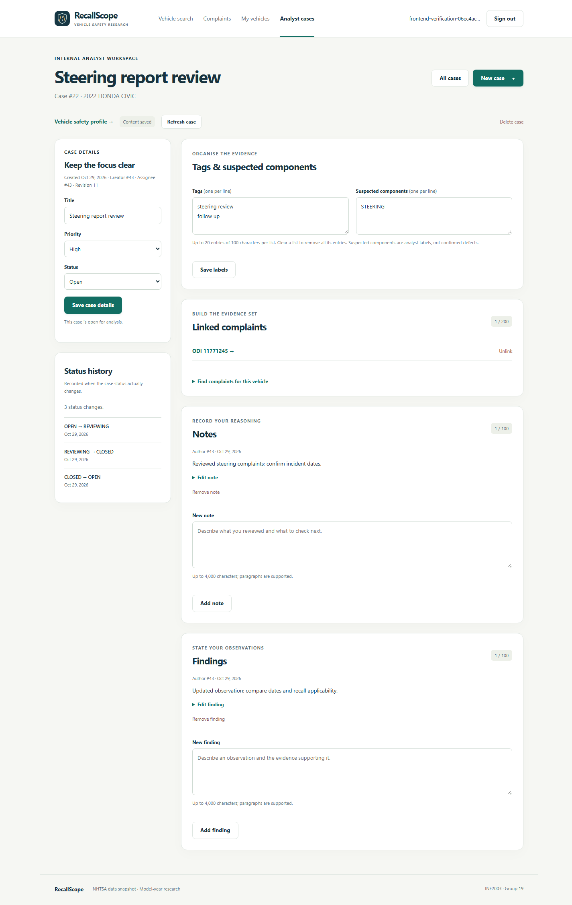
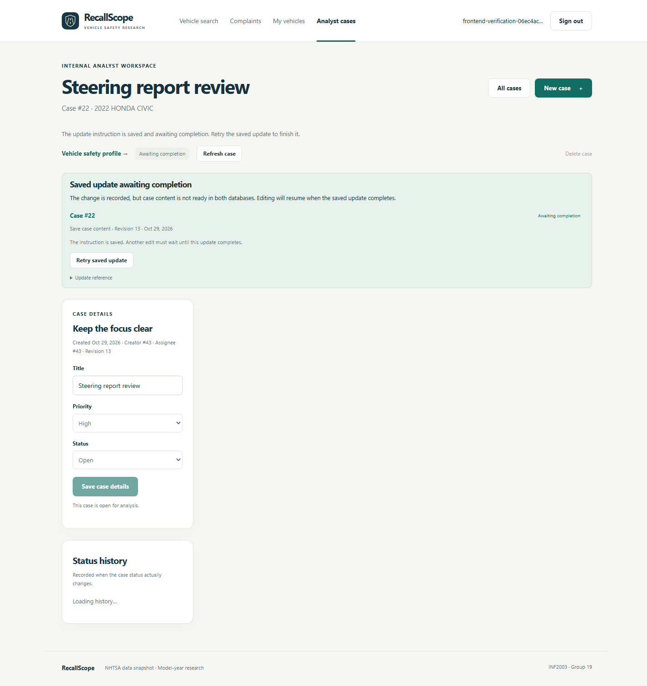

# Frontend step 3 — Analyst case workspace

Implemented and verified on **29 October 2026 (Asia/Kuala_Lumpur)**. Analysts can
now manage their internal cases in RecallScope's browser interface. Overall
development remains in **Stage 7**. Fleet/work-order browser screens are next.

## Prepare access and open the workspace

Ordinary registration creates a **NORMAL_USER**, who can research vehicles and
use personal saves but cannot manage analyst cases. This workspace requires
**ANALYST or ADMIN**. On 29 October, after verification cleanup, a read-only account
count showed one normal user and no persistent analyst/admin account. Testing did
not promote that existing account or leave a demo login.

If you have not yet created the project's first administrator, run this locally:

```powershell
.\.venv\Scripts\python.exe scripts/create_admin.py
```

Use a **new email** and choose a password at the hidden prompts. This creates a
persistent ADMIN application account; the helper refuses if an administrator
already exists. Keep the password on your computer. It is separate from the
database passwords in `.env`. An admin can use the case workspace directly and
can assign ANALYST access through the existing admin API. The graphical role
management screen remains a later milestone.

Restart an older Flask process with Ctrl+C, then run:

```powershell
.\.venv\Scripts\python.exe -m flask --app backend:create_app run --host 127.0.0.1 --port 5000
```

Open [RecallScope](http://127.0.0.1:5000/), sign in as an analyst/admin and click
**Analyst cases**. Alternatively, open a vehicle profile and choose **Open an
analyst case for this vehicle**. These links appear only for the applicable roles;
the APIs independently check permissions on every request.

## A first case walkthrough

1. Choose **New case**, find **2022 HONDA CIVIC**, and explicitly select the result.
   A profile link fills the search fields but still asks you to select the vehicle.
2. Enter a title such as **Steering report review**, choose a priority and create
   the case. Its make/model/year, creator and assignee stay fixed after creation.
3. Change its status to **Reviewing**. The sidebar displays SQL-triggered status
   history. Closing records a timestamp; reopening clears it.
4. Add tags and suspected components, one per line. For example, use **steering
   review** as a tag and **STEERING** as a suspected component. Clear a list to remove
   all its entries.
5. Expand **Find complaints for this vehicle**. Filter by **STEERING** or narrative
   words, inspect a full complaint and click **Link to this case**. The picker
   searches only this case's vehicle. Unlinking does not delete the imported report.
6. Write a note explaining what you reviewed and a finding stating your observation
   and supporting evidence. Entries support paragraphs, editing and confirmed
   removal. The original author/time remain when an entry is edited.
7. Return to **All cases** to see the case files and saved update receipts. Your
   changes persist after signing out.

These are internal analysis records, separate from official NHTSA investigations.
Complaints remain allegations, and suspected components are analyst labels.
Deleting a case removes its internal content/history; imported safety data remains.
Removal dialogs allow cancellation before a request is sent.

## What each role sees

| Role | Browser behavior and server authority |
| --- | --- |
| Signed out | Sign-in prompt; private content is cleared. |
| NORMAL_USER | Role explanation; case APIs return 403. Research and personal saves remain available. |
| ANALYST | List/create/read/edit/delete their own cases, entries and saved updates. Another analyst's case URL returns the same missing-case state as an unknown ID. |
| ADMIN | Explicit oversight of all analyst cases and their recovery updates. New notes/findings record the admin as their actual author. |

The admin exception applies to cases. Personal saved vehicles and fleets retain
their established owner-only rules. Browser visibility is a convenience; API
authorization remains the protection. Page history restoration refreshes account
access, and a denied request after session expiry clears workspace data.

## Understand the two recovery controls

Case metadata/history live in PostgreSQL. Flexible content lives in MongoDB. A
case change saves a durable instruction in SQL before applying the content update.
The browser now makes this existing backend recovery workflow usable.

| What the page says | Meaning | What to do |
| --- | --- | --- |
| **Content saved** / **Case change saved** | The server returned an applied update receipt. | Continue working. |
| **Saved update awaiting completion** | The server returned PENDING: the instruction exists, but completion across the two stores is unresolved. | Use **Retry saved update**. Editing stays blocked and unsynchronized content is hidden. |
| **Change not yet confirmed** | A connection/server error left the outcome uncertain. The browser retains that exact request and its UUID in memory. | Keep the page open and choose **Retry same change**. This resends the original payload with the same request key. |

Retrying the same command prevents a lost response from creating a duplicate note
or case. A fresh edit uses a new UUID. The client does not automatically retry
writes or submit a new edit while an uncertain command is retained.

The uncertain command's body is kept only in memory; it is not saved to browser
storage. Leaving/reloading loses that local retry body, and the browser requests
confirmation before leaving an unresolved command. If you do leave, inspect the
case and pending/completed receipts before submitting the work again. A pending
SQL instruction survives reload and remains available through the receipt list.

For a deletion, the SQL case can already be gone while its MongoDB deletion is
pending. **All cases → Saved update receipts → Awaiting completion** retains that
deletion task so it can still be retried. A retry that remains pending keeps the
pending state; it is not displayed as a completed save. No background retry worker
or distributed transaction is claimed.

## Limits and implementation

The existing server limits apply: title 200 characters, 20 tags/components of
100 characters each, 200 complaint links, 100 notes and 100 findings, with 4,000
characters per entry and a 512 KB serialized content limit. Request bodies remain
limited to 16 KB. The UI reports server validation failures and keeps input for
correction. Assignment/reassignment and changing a case's vehicle are not exposed.

| File | Responsibility |
| --- | --- |
| `backend/templates/case_base.html`, `cases.html`, `case_new.html`, `case_detail.html` | Workspace shells, role gate, case forms, history, complaint picker and receipt/recovery views. |
| `backend/static/cases.js` | Role-aware rendering, private-data cleanup, form actions, confirmation, pagination and exact-command recovery. |
| `backend/static/api.js` | Existing same-origin cookie/CSRF client; now accepts the case idempotency key. |
| `scripts/support/frontend_case_fixtures.py` | Temporary test actors and controlled projection/deletion failures, enabled only by the verifier. Normal app startup does not install them. |
| `scripts/browser/browser_case_checks.mjs` | Additional real-browser case journeys, invoked with `--cases`. |

Private HTML shells contain no stored case information. Browser requests obtain
data through existing role/ownership-checked APIs. User text is rendered as text
nodes or input values. No schema migration, new service credential, package install
or dataset reimport is needed for this milestone.

## Verification

On **29 October 2026**:

- **151 automated tests passed**, with the HTML/API boundary coverage extended to
  case pages and the new static module. JavaScript syntax checks passed.
- **115 real-browser checks passed in Chrome 156.0.8078.73**, including the earlier
  research/auth/saved/explorer journeys and case-specific checks.
- Case checks exercised creation, metadata/status/timestamps, tags/components,
  complaint selection/link/unlink, note/finding create/edit/delete, reload
  persistence, cancellation and case deletion.
- Normal-user denial, two-analyst isolation, foreign URL denial, admin oversight,
  entry authorship, demoted-account denial, logout/history privacy and live
  session-expiry cleanup passed.
- A deliberately lost response after a real note commit was retried with the
  original key and produced one note. Controlled MongoDB projection failures
  returned pending, survived page reload, stayed pending on another failure, and
  completed through the saved retry control. Pending deletion remained recoverable
  after the SQL case was removed.
- Case files, completed receipts, complaint candidates and status history paginated
  against real fixture records. An interrupted detail read disabled mutations until
  a successful refresh. Stored title/note markup rendered literally.
- Desktop and 390px mobile output were checked; screenshots were reviewed. No
  uncaught browser JavaScript exceptions were recorded.
- All owned synthetic users/sessions/saves/cases/content/history/operations were
  removed; checked original/reference counts matched the baseline. Native services
  stayed running. Existing accounts and earlier milestone evidence were retained.

Evidence: [frontend_step_3_verification_report.json](../frontend_step_3_verification_report.json).
These checks do not constitute a full accessibility audit, every-browser guarantee
or performance benchmark. Recovery faults are injected at the service/client
boundaries in the owned verifier; this does not test stopping Windows services.

```powershell
.\.venv\Scripts\python.exe -m unittest discover -s tests -v
.\.venv\Scripts\python.exe scripts/verify_frontend.py --cases
```

The optional browser verifier uses installed Chrome/Edge and Node.js 22+. `--cases`
includes the earlier research checks and writes step-3 evidence/screenshots without
overwriting steps 1/2. It starts/stops its own temporary server/browser and uses
synthetic credentials passed through stdin. Cleanup affects only its owned fixture
records. Sequence counters advance during test CRUD; stored records are preserved.

## Screenshots and next work





[Case files and receipts](../screenshots/frontend-step-3/cases-desktop.png) and
[mobile case workspace](../screenshots/frontend-step-3/case-detail-mobile.png).

Next: fleet vehicles, recall matches and work-order browser screens. Admin user/role
screens, dataset/import-log reads, dashboards/analytics, performance experiments,
broader final evaluation and submission materials remain planned.
