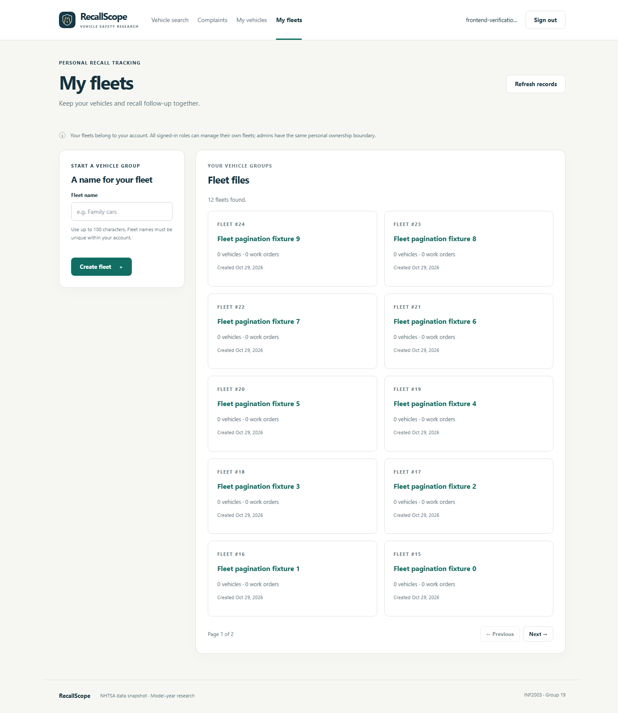
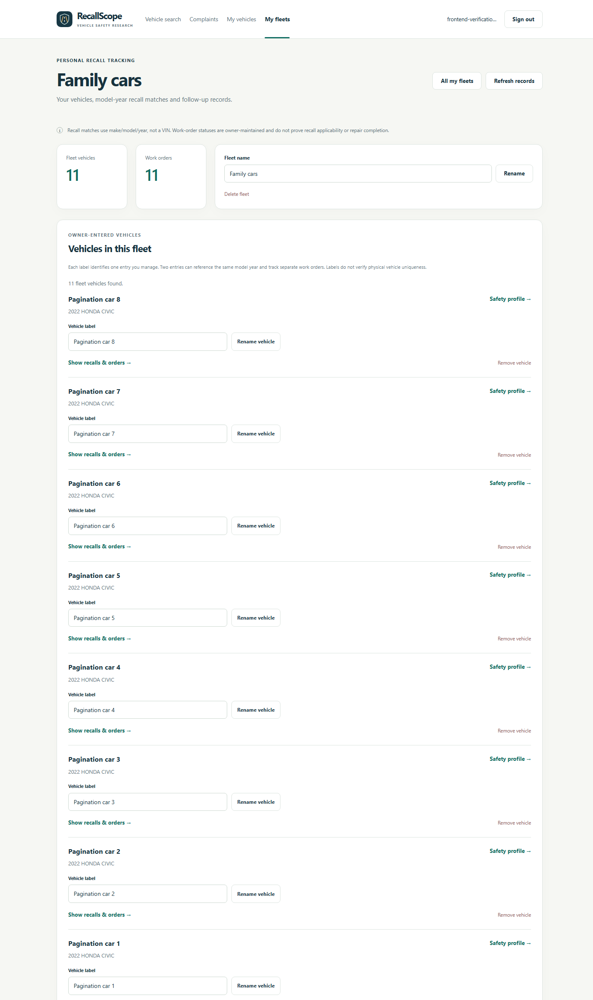

# Frontend step 4 — Fleets and recall work orders

Implemented and verified on **29 October 2026 (Asia/Kuala_Lumpur)**. RecallScope now
provides fleet vehicle management, model-year recall matching and work-order
tracking through browser pages. Overall development remains in **Stage 7**;
admin screens/data reads and analytics integration remain.

## Open the pages with your existing account

This workflow is available to **every signed-in role**, including NORMAL_USER.
You can use your existing normal account; analyst/admin setup is not required
for personal fleets. Each account sees only its own fleets and work orders.
The milestone's separate read-only account-role check records one persistent ADMIN
and one NORMAL_USER; both existing roles were retained. The earlier case milestone
describes the setup before that admin was prepared. First-admin bootstrap does not
need to be repeated on this computer.

Stop an older Flask terminal with Ctrl+C, then restart:

```powershell
.\.venv\Scripts\python.exe -m flask --app backend:create_app run --host 127.0.0.1 --port 5000
```

Open [RecallScope](http://127.0.0.1:5000/), sign in and click **My fleets**.
Your database records persist across server restarts. No schema change, reimport,
new `.env` value or runtime package installation is needed for these pages.

## A first fleet walkthrough

1. Create a fleet named **Family cars**.
2. Expand **Add a vehicle to this fleet**, search **HONDA / CIVIC / 2022**, select
   the result, and add it with your label **Car 1**.
3. The imported snapshot provides **4 vehicle–recall matches** for that entry.
   Add **Car 2** referencing the same catalogue identity to see **8 pairs**.
4. Choose **Show recalls & orders** on a vehicle to scope both lists to that
   labelled entry. **Show all fleet vehicles** returns to the broader fleet view.
5. Open an official recall to read its remedy, or choose **Create work order** on
   an untracked match. Add optional notes; the order starts **Open**.
6. Edit its status/notes, save, and return through **Open fleet**. Filter recall
   matches by tracked/untracked and work orders by their status.
7. Try **Completed**, save it again, then reopen it. Completion sets a timestamp,
   repeating Completed preserves it, and another status clears it.

Labels and notes are your own tracking data. This system does not validate or
store a VIN, establish VIN-specific recall applicability, or verify repairs.
Marking an order Completed means you entered that tracking status.

## What the browser now supports

| Page | Working behavior |
| --- | --- |
| `/fleets` | Owner's paginated fleets, vehicle/order counts and a create form. |
| `/fleets/{fleetId}` | Rename/delete the fleet; search/select/add catalogue vehicles; rename/remove vehicle labels; recall matches and work-order lists with filters and independent pagination. |
| `/fleets/{fleetId}?vehicle={fleetVehicleId}` | The same fleet view with matches/orders scoped to one of its labelled vehicles; the vehicle must belong to this fleet. |
| `/work-orders/{workOrderId}` | Status/notes editing, completion date, vehicle/recall facts, links back to fleet/profile/official recall and confirmed deletion. |

Fleet, vehicle, match and order lists use 10 entries per page. Vehicle catalogue
search also supports pagination. Empty/error/loading states and refresh controls
are provided. The normal application sign-in flow returns to known local fleet
or order pages and preserves the selected-vehicle query where present.

Recall orders can be created only from a matching owned fleet vehicle/recall pair.
An existing order is opened rather than offered as another create. If another
request creates it while a dialog is open, the server rejects the duplicate and
the refreshed list exposes the existing order.

**Cancelled is still tracked.** A cancelled order still occupies its vehicle–recall
pair. Open it to correct its status; creating another order for that pair is not
allowed. Deleting the order makes the match untracked again.

## Vehicle identities, bookmarks and fleet entries

| Record | Example and meaning |
| --- | --- |
| Catalogue vehicle | The shared make/model/year identity **2022 HONDA CIVIC**. |
| Personal saved vehicle | Your bookmark of that catalogue identity in **My vehicles**. |
| Fleet vehicle | Your labelled entry **Car 1**, inside **Family cars**, referencing the catalogue identity. |

Two fleet entries can reference the same catalogue vehicle and have separate work
orders. Therefore two Civics can match the same four campaigns twice: eight
vehicle–recall pairs, not eight different campaigns. Owner-entered labels do not
verify that two entries refer to different physical cars.

Fleet names are unique per owner and vehicle labels per fleet. Both trim outer
whitespace, preserve case and allow 1–100 printable characters. Uniqueness is case
sensitive. Different owners can reuse the same names. A fleet vehicle's catalogue
identity/fleet and a work order's vehicle/recall pair stay fixed; their editable
fields are labels, names, notes and tracking status as appropriate.

## Ownership and removal

All signed-in roles have the same **personal owner boundary** for fleets. Admin
case oversight does not grant access to someone else's fleet or work order.
Guessed foreign IDs receive the same not-found state as missing records. The
backend derives the owner from the session and checks every read/write.

| Confirmed removal | What is removed |
| --- | --- |
| Work order | That personal order only; its match becomes untracked. |
| Fleet vehicle | That labelled entry and all its work orders. |
| Fleet | The fleet, all its vehicle entries and all their work orders. |

The dialogs explain these consequences and allow cancellation before a request is
sent. These PostgreSQL cascades do not delete imported catalogue vehicles, official
recalls, complaints or investigations. Another fleet's records remain.

Signing out or receiving a session-expiry denial clears private fleet content.
History restoration checks account access before loading it again. Private page
shells contain no stored owner records; the existing APIs supply data after checks.

## Saves, errors and how this differs from cases

Fleet/vehicle/order changes use PostgreSQL transactions and constraints. They do
not need the case workflow's SQL-to-MongoDB pending-content instruction. MongoDB
still supplies complaints elsewhere in the application.

A successful fleet write refreshes the relevant records or opens the new fleet/
order. Validation and duplicate errors are displayed without inserting another
record. Notes allow up to 2,000 characters and paragraphs; blank text clears them.
Owner-controlled text uses DOM text nodes/input values rather than HTML parsing.

If a connection/server failure or unreadable successful response leaves a write's
outcome uncertain, the UI blocks additional changes and shows **Refresh and review
records**. That button reads current data; it does not automatically repeat the
write. Review the displayed values before deciding whether another change is
needed. On a fleet detail page, this review clears match/status filters so an
already-saved order is easier to find. A failed detail read also blocks editing
until a trusted snapshot is loaded.

Cases have their own idempotency-key retry protocol. That existing handler was
also hardened in this milestone to retain the exact command if an HTTP success
arrives with unreadable JSON. The new browser checks cover both behaviors.

## Implementation and verification

| File | Responsibility |
| --- | --- |
| `backend/pages.py` and fleet templates | Public HTML shells for the protected fleet/order UI. |
| `backend/static/fleets.js` | Owner workspace, forms/dialogs, filters/pagination, read-before-resubmit handling and private-data cleanup. |
| `backend/static/app.js` / `app.css` | Navigation, safe sign-in return paths, account lifecycle and responsive styling. |
| `scripts/browser/browser_fleet_checks.mjs` | Native-database fleet/order browser journeys, including privacy and dependent-record deletion. |

These pages reuse the existing fleet APIs, SQL tables/view and limited workflow
role. No new migration, external site or deployment was introduced.

Verification on **29 October 2026**:

- **151 automated tests passed**, with existing page/API-boundary checks extended
  to fleet/order pages and their static module. JavaScript syntax checks passed.
- **163 real-browser checks passed in Chrome 156.0.8078.73**, including earlier
  research/auth/saved/case journeys and the new fleet/order workflows.
- Fleet checks exercised create/rename, vehicle search/selection/add/rename,
  duplicate names/labels, two entries with the same catalogue identity, matched
  orders, status/notes editing, closing/reopening timestamps and reload persistence.
- Tracked/status/selected-vehicle filters and independent fleet/vehicle/match/order
  pagination used real owned records. Concurrent duplicate order creation showed
  its existing order; cancellation and confirmed deletion/cascades passed.
- Another normal account and an admin were denied access to the owner's records.
  Logout/history and session-expiry cleanup passed. Stored name/label/note markup
  remained literal. A failed detail read disabled editing until refresh succeeded.
- Lost and unreadable responses after real commits produced a review prompt rather
  than another automatic POST. Case command retry after unreadable JSON retained
  one note. No uncaught browser JavaScript exceptions were recorded.
- Desktop and emulated 390px mobile output were checked and screenshots reviewed.
  Owned test users/sessions/saves/cases/content/tasks/fleets/vehicles/orders were
  removed; checked existing/reference counts matched the baseline.

Evidence: [frontend_step_4_verification_report.json](../frontend_step_4_verification_report.json).
Earlier evidence remains dated historical material. These checks are not a full
accessibility audit, every-browser guarantee or query-performance benchmark.

```powershell
.\.venv\Scripts\python.exe -m unittest discover -s tests -v
.\.venv\Scripts\python.exe scripts/verify_frontend.py --fleets
```

The optional browser verifier uses installed Chrome/Edge and Node.js 22+ through
local DevTools automation. `--fleets` includes the earlier journeys and writes
step-4 evidence/screenshots without overwriting steps 1–3. It owns and stops its
temporary Flask server/browser, passes synthetic credentials through stdin and
removes only its fixture records. Existing account roles and native services are
retained. Sequence counters advance during fixture CRUD. Node is test tooling,
not a frontend runtime/build dependency.

## Screenshots and next work





[Work-order editor](../screenshots/frontend-step-4/work-order-desktop.png),
[mobile fleet view](../screenshots/frontend-step-4/fleet-mobile.png) and
[mobile work-order editor](../screenshots/frontend-step-4/work-order-mobile.png).

Next: admin user/role and dataset/import-log views, including remaining read APIs.
Dashboard/analytics integration, performance experiments, wider evaluation and the
report/video/final submission package remain planned.
