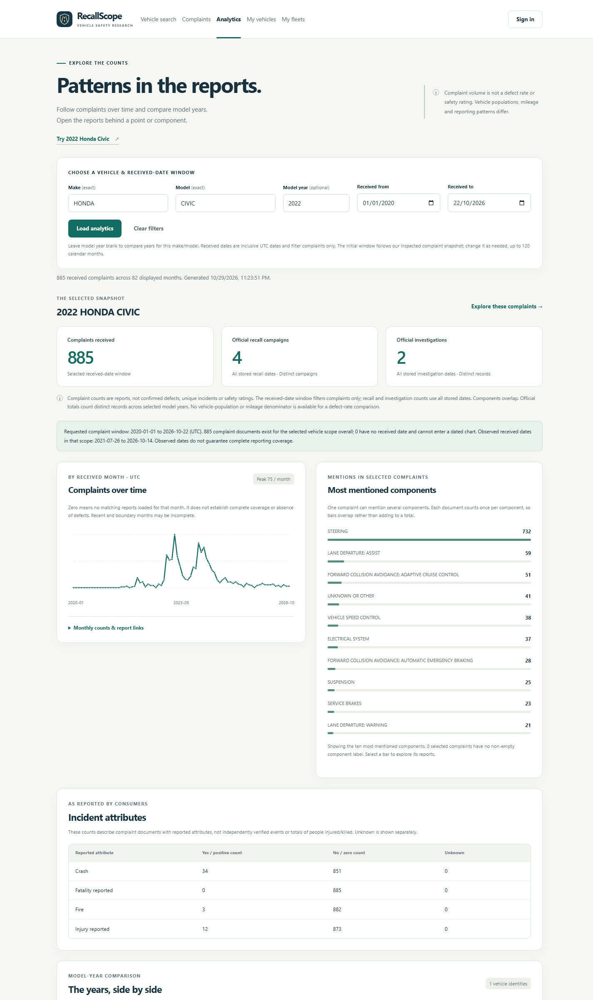
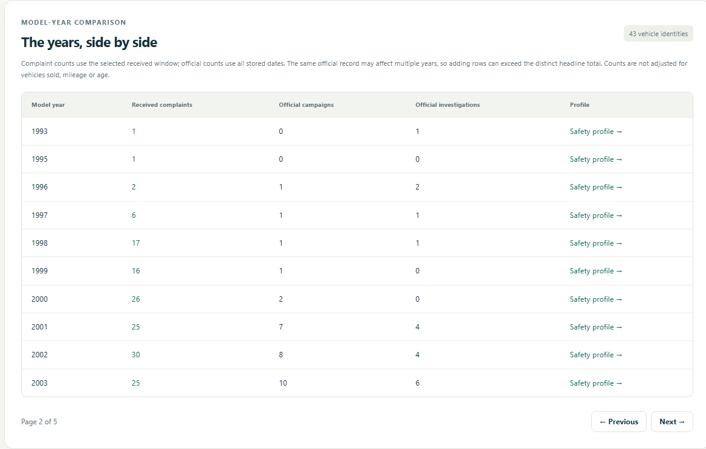

# Frontend step 6 — Vehicle analytics and complaint charts

Implemented and verified on **29 October 2026 (Asia/Kuala_Lumpur)**. This completes
the first planned browser implementation, including the promised complaint
component/time charts. Overall work now moves into **Stage 8: evaluation and
performance experiments**. Submission materials and final review remain.

## Try the dashboard

Restart an older Flask terminal with Ctrl+C, then run:

```powershell
.\.venv\Scripts\python.exe -m flask --app backend:create_app run --host 127.0.0.1 --port 5000
```

Open [Analytics](http://127.0.0.1:5000/analytics), then **Try 2022 Honda Civic**.
Research analytics is public; no application account is needed. You can also open
it from a vehicle profile using **View complaint charts & model-year comparison**.

The initial received-date window is **1 January 2020–22 October 2026**, matching
the inspected complaint archives. It is an editable snapshot default, not an
automatic claim of live coverage. Choose exact make/model names, optionally a
model year, and an inclusive received-date window of at most 120 calendar months.
Leaving year blank compares the catalogue years for that make/model.

For the Civic example this window produces **885 complaint documents**, **4
distinct recall campaigns**, **2 official investigations** and **732 complaints
mentioning STEERING**. Clearing the model year gives 43 Civic catalogue identities,
5,099 received complaints, 44 distinct campaigns and 20 official investigations
in this imported snapshot.

## Read the panels correctly

| Panel | Counting rule |
| --- | --- |
| Complaints received | One merged complaint document received within the selected inclusive UTC date window. |
| Official recall/investigation headlines | Distinct official records matching the selected vehicle identities, using **all stored dates**. The complaint receipt window does not filter these records. |
| Complaints over time | Matching documents grouped by received month in UTC; every requested month is shown, including zero-valued months. |
| Components | Each document counts once per non-empty component label; a document can contribute to multiple bars. Only the top ten labels are displayed. |
| Incident attributes | Complaint documents with crash/fire yes/no/unknown or injury/fatality positive/zero/unknown values. These are not totals of unique events or people. |
| Model-year comparison | Selected-window complaint counts and all-date official counts per catalogue identity; the bounded result has client-side pagination. |

Several model years can share one official campaign/investigation. Adding the
comparison rows can therefore exceed the distinct headline total. Complaint
counts, by contrast, partition by their canonical model-year ID.

The coverage note shows how many complaint documents exist in the selected vehicle
scope overall, how many have no received date, and the earliest/latest observed
dated records. Undated documents cannot be assigned to the selected window or
monthly chart and are disclosed separately. Observed dates do not guarantee that
every intervening period is fully covered. A zero means no matching loaded reports;
recent or partial months can be incomplete.

These are descriptive counts, not defect rates, predictions or safety scores.
Vehicle population, mileage, age and reporting exposure are not controlled. A
higher complaint count alone does not establish that a vehicle is less safe.
Internal analyst cases are not included in the official investigation counts.

## Follow a chart back to the records

- Click a component bar to open the complaint explorer with the same vehicle,
  component and received-date filters.
- Click or keyboard-focus a monthly point and press Enter to open its complaint
  reports. The link clips the first/last month to the selected dates.
- Expand **Monthly counts & report links** for exact values and date boundaries.
  Partial selected months are labelled. The table is an alternative to interpreting
  the plot visually.
- Comparison rows link to that year's complaint reports and safety profile.

Filters are included in a shareable/reloadable URL. Invalid or unknown vehicle
requests clear earlier charts and show an error/empty state. A failed connection
clears loading and leaves the form retryable. Cancelling a request prevents a late
response from replacing a newer selection. A valid vehicle with no complaints in
the requested window still shows zero-valued complaint charts and official counts.

## New read-only API and queries

`GET /api/analytics/vehicle` accepts:

| Parameter | Validation |
| --- | --- |
| `make`, `model` | Required exact names, normalized like existing research searches. |
| `year` | Optional catalogue model year, 1900–2100. |
| `receivedFrom`, `receivedTo` | Required valid `YYYY-MM-DD` dates, inclusive in UTC, ordered, within 1900–2100 and spanning at most 120 calendar months. |

Unknown/duplicate fields and invalid types/ranges are rejected before opening the
SQL reader. An unknown catalogue scope returns 404; an empty complaint result for
an existing scope returns 200 with zero counts. No write method is provided.

The service first resolves at most 201 canonical catalogue identities using the
existing restricted SQL reader/views. SQL aggregates recalls and investigations
independently; a selected-identity CTE with `COUNT(DISTINCT ...)` avoids multiplying
counts across joined relationships and model years. Input values are bound SQL
parameters. No additional SQL grants or schema change were needed.

MongoDB then matches those IDs and projects only the fields needed for analytics.
A single bounded `$facet` aggregation computes window totals, component mentions,
received months, per-vehicle counts and overall date coverage. The component stage
uses set semantics to avoid counting one label twice in a document. The operation
uses `maxTimeMS=5000`; the existing SQL statement limits also apply. Python fills
missing month buckets and clips their drill-through boundaries. Existing reference
indexes are retained; this milestone is not a before/after-index benchmark.

The response contains only selected reference aggregates, coverage and model-year
labels/IDs. It does not return narratives, private cases, fleet/user records,
database passwords or session information. SVG/HTML rendering uses DOM text and
attributes, not record-text HTML interpolation. There are no new frontend build,
chart-library or runtime dependencies.

| File | Responsibility |
| --- | --- |
| `backend/analytics.py` | Public typed/validated analytics endpoint. |
| `backend/services/analytics.py` | SQL distinct totals and MongoDB aggregation/counting rules. |
| `backend/templates/analytics.html`, `backend/static/analytics.js` | Form, interactive chart/component links, exact-value tables and comparison pagination. |
| `scripts/support/analytics_checks.py` | Native query comparisons and owned validator-backed temporary-collection edge cases. |
| `scripts/browser/browser_analytics_checks.mjs` | Actual dashboard, keyboard drill-through, error, stale-response and responsive checks. |

## Verification

On **29 October 2026**:

- **170 automated tests passed**: the previous 159 plus eleven analytics tests for
  normalization, distinct totals, zero/partial months, unknown incident attributes,
  overlapping/top-ten components, empty/unknown scopes, bounded queries, SQL
  parameters, sanitized failures and read-only methods. Page/asset coverage was extended.
- **219 real-browser checks passed in Chrome 156.0.8078.73**, including all earlier
  research/auth/saved/case/fleet/admin journeys plus the dashboard journeys.
- Native Civic counts matched the established 885/4/2 and STEERING 732 values.
  Monthly results matched an independent scan/count of received dates. All-Civic
  distinct totals were compared with a separate SQL relationship query.
- An owned temporary collection with the real complaint validator tested inclusive
  UTC boundaries, a zero month, overlapping labels, empty components, missing dates,
  unknown flags/numbers, partial windows and empty results. It was removed afterward.
- Component/month links opened the matching reports; a monthly point was activated
  with the keyboard. Shared URLs, all-year pagination, date validation, zero-data
  windows, read failures/retry, literal input markup and late-response cancellation passed.
- Desktop and 390px mobile output were reviewed, with exact-value tables contained
  in labelled keyboard-focusable scroll regions. No uncaught browser JavaScript
  exceptions were recorded.
- Owned accounts/content/tasks/fleets/orders and the temporary analytics collection
  were removed; checked original/reference counts and import history were preserved.
  Earlier milestone reports/screenshots remain historical evidence.

Evidence: [frontend_step_6_verification_report.json](../frontend_step_6_verification_report.json).
This is functional/counting evidence, not a complete accessibility audit, all-browser
guarantee or index-performance comparison.

```powershell
.\.venv\Scripts\python.exe -m unittest discover -s tests -v
.\.venv\Scripts\python.exe scripts/verify_frontend.py --analytics
```

The optional verifier needs installed Chrome/Edge and Node.js 22+. It includes all
earlier journeys and writes step-6 evidence/screenshots without replacing steps
1–5. It starts/stops an owned temporary server/browser, passes synthetic credentials
through stdin and cleans only its own test data. Existing accounts/roles and native
services are retained. No source reimport is performed.

## Screenshots and next stage





[Mobile dashboard](../screenshots/frontend-step-6/analytics-mobile.png).

Next: controlled PostgreSQL/MongoDB index-performance experiments with representative
workloads, query plans and repeated timings, followed by broader final evaluation.
The report, slides, all-member video, user manual and reproducible submission
package remain. A working first frontend does not make the project ready to submit.
